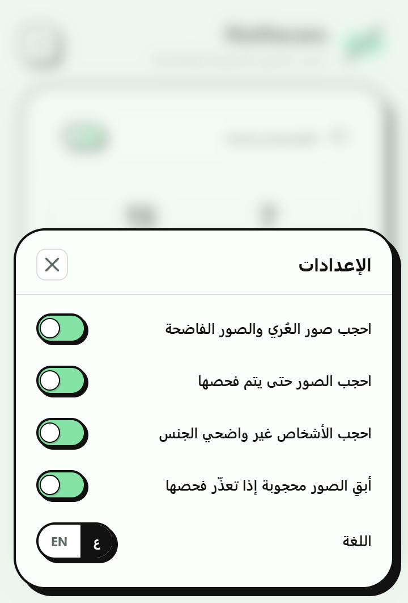
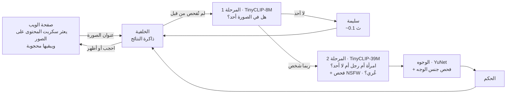

<p align="center">
  <a href="README.md">English</a> · <b>العربية</b>
</p>

<p align="center">
  
</p>

<h1 align="center">NoHaram</h1>

<div dir="rtl" align="center">

**احجب الصور المحرّمة والفاضحة**<br>
إضافة للمتصفح تحجب صور النساء أو الرجال أو كليهما، وتحجب صور العُري وغيرها من الصور الفاضحة (NSFW)، فور ظهورها في الصفحة. كل شيء يعمل على جهازك.

</div>

<p align="center">
  <a href="LICENSE"></a>
  
  
  
  
</p>

<p align="center">
  
  &nbsp;
  
  &nbsp;
  
</p>

<div dir="rtl">

## المزايا

- **اختر من تريد حجبه:** النساء أو الرجال أو كليهما، في كل المواقع.
- **يحجب الصور الفاضحة (NSFW):** تُحجب صور العُري وغيرها من الصور الفاضحة أيّاً كان من فيها. هذا الخيار مفعّل افتراضياً.
- **الخصوصية أولاً:** تعمل نماذج الذكاء الاصطناعي داخل متصفحك. لا تُرسَل أي صورة أو رابط أو سجل تصفح إلى أي مكان، ولا توجد حسابات ولا إحصاءات ولا إعلانات.
- **لا شيء يظهر فجأة:** تبقى الصور محجوبة أثناء تحميلها وفحصها، ثم لا يبقى محجوباً منها إلا ما يطابق اختيارك.
- **يجد الصور مهما كانت طريقة عرضها في الموقع:**
  - الصور العادية و`srcset` و`<picture>`
  - الصور ذات التحميل المتأخر، وعروض الصور المتتابعة، وخلفيات CSS
  - ‏shadow DOM والإطارات (iframes) وصور `blob:`
  - الصور المصغّرة حتى 24 بكسل
- **التحكم بيدك:**
  - ثلاثة مستويات للحساسية
  - مفتاح تشغيل وإيقاف لكل موقع
  - انقر بزر الفأرة الأيمن واختر **أظهر هذه الصورة** أو **احجب هذه الصورة** لتصحيح خطأ في صورة واحدة
- **العربية والإنجليزية**، مع واجهة من اليمين إلى اليسار بالعربية.
- **يعمل على** Chrome وEdge وBrave وغيرها من متصفحات Chromium، وعلى Firefox في الحاسوب وأندرويد.

## التثبيت

تحتاج إلى [Node.js](https://nodejs.org) الإصدار 22 أو أحدث.

</div>

```bash
git clone https://github.com/mohamedsadiqaguenaou/NoHaram.git
cd NoHaram
npm install
npm run build
```

<div dir="rtl">

ثم حمّل المجلد المبني. استخدم `dist/` وليس `src/`:

| المتصفح | الطريقة |
|---|---|
| Chrome / Edge / Brave | افتح `chrome://extensions`، وفعّل **وضع المطوّر** (Developer mode)، ثم انقر **تحميل الإضافة غير المضغوطة** (Load unpacked) واختر `dist/chrome` |
| Firefox للحاسوب | افتح `about:debugging#/runtime/this-firefox`، وانقر **تحميل إضافة مؤقتة** (Load Temporary Add-on) واختر `dist/firefox/manifest.json` |
| Firefox لأندرويد | `npx web-ext run -t firefox-android -s dist/firefox` مع هاتف موصول عبر USB ‏([الدليل](https://extensionworkshop.com/documentation/develop/developing-extensions-for-firefox-for-android/)) |

- **حزم جاهزة:** تُرفق الحزم المبنية مسبقاً بكل [إصدار](https://github.com/mohamedsadiqaguenaou/NoHaram/releases). ويمكنك بناؤها بنفسك بالأمر `npm run zip`، فتُحفظ في `dist/noharam-<browser>-<version>.zip`.
- **Firefox:** إذا ظهرت في النافذة رسالة *يحتاج NoHaram إلى الوصول إلى المواقع*، انقر **السماح على جميع المواقع**.
- **تخطّي متصفح الاختبار:** ينزّل `npm install` أيضاً نسخة اختبار من Chrome بحجم 150 ميغابايت تقريباً. إذا كنت تريد البناء فقط، فاستخدم `PUPPETEER_SKIP_DOWNLOAD=1 npm install`.

## طريقة الاستخدام

انقر على أيقونة الإضافة في شريط الأدوات:

- **بطاقة الموقع:** الموقع الحالي، مع مفتاح لإيقاف الفلترة في هذا الموقع وحده.
- **اللوحة المباشرة:** عدد الصور المحجوبة والمفحوصة في الصفحة.
- **احجب صور:** النساء أو الرجال أو كليهما.
- **الحساسية:** منخفضة أو متوازنة (الافتراضية) أو صارمة. انظر [الدقة](#الدقة).
- **تشغيل / إيقاف:** يوقف الفلترة في كل مكان أو يعيدها.
- **الإعدادات** (أيقونة الترس):
  - *احجب صور العُري والصور الفاضحة* (مفعّل افتراضياً)
  - *احجب الصور حتى يتم فحصها* (مفعّل افتراضياً)
  - *احجب الأشخاص غير واضحي الجنس* (مفعّل افتراضياً)
  - *أبقِ الصور محجوبة إذا تعذّر فحصها* (مفعّل افتراضياً)
  - *اللغة*

انقر بزر الفأرة الأيمن على أي صورة واختر **NoHaram: أظهر هذه الصورة** أو **NoHaram: احجب هذه الصورة** لتصحيح خطأ. وتعرض الشارة على أيقونة الإضافة عدد الصور المحجوبة في التبويب الحالي.

## الخصوصية

ليس لـ NoHaram أي خادم. لا تُجري الإضافة أي طلبات شبكة خاصة بها سوى تنزيل الصور التي تعرضها الصفحة أصلاً، من العناوين نفسها، لكي تفحصها.

وتحتفظ على جهازك بما يلي:
- إعداداتك
- ذاكرة مؤقتة للنتائج، حتى لا تُفحص الصورة نفسها مرتين. تحفظ هذه الذاكرة بصمة SHA-256 لعنوان كل صورة مع نتائج فحصها، في التخزين الخاص بالإضافة.

لا يُجمع أي شيء ولا يُسجَّل ولا يُشارَك. انظر [PRIVACY.md](PRIVACY.md).

| الإذن | السبب |
|---|---|
| الوصول إلى جميع المواقع | للعثور على الصور في كل صفحة وتنزيلها لفحصها |
| `storage` | الإعدادات وذاكرة النتائج وأعداد الشارة |
| `contextMenus` | خيارا **أظهر / احجب هذه الصورة** في قائمة الزر الأيمن |
| `scripting` | لاستلام التبويبات المفتوحة مسبقاً بعد تحديث الإضافة أو إعادة تشغيلها |
| `offscreen` (Chrome فقط) | لتشغيل محرك الذكاء الاصطناعي في صفحة خلفية، لأن عمّال الخدمة (service workers) في MV3 لا يستطيعون تشغيل عمّال الويب |

## كيف يعمل

</div>



<div dir="rtl">

- **مرحلتان.** يستبعد نموذج سريع أولاً الصور التي لا يظهر فيها أشخاص: الشعارات والرسوم البيانية والمنتجات والمناظر الطبيعية، وهي معظم ما في الويب. ولا يخضع للفحص الأبطأ والأدق إلا الصور التي قد تحتوي على شخص، وهو يفحص الصورة كاملة وما يصل إلى وجهين. ويفحص مصنِّف صغير للمحتوى الفاضح (NSFW) الصور نفسها بحثاً عن العُري.
- **التصنيف دون تدريب (zero-shot).** النماذج من نوع [CLIP](https://arxiv.org/abs/2103.00020) التي تربط الصور بالنصوص: تقارن الصورة بجمل بسيطة مثل *"a photo of a woman"* و*"a photo of a man"* و*"a logo"*. هذه الجمل موجودة في [`scripts/models/prompts-stage2.json`](scripts/models/prompts-stage2.json). لم يُدرَّب أي شيء خصيصاً لهذه الإضافة.
- **تبقى الصفحة سلسة:**
  - لا تقوم الصفحة نفسها إلا بتتبّع الصور الموجودة وتطبيق الحجب.
  - يجري التنزيل وفكّ الترميز وتشغيل النماذج كلها في عمّال الخلفية الخاصة بالإضافة، باستخدام WebAssembly ‏(ONNX Runtime Web، ‏SIMD، خيط واحد لكل عامل).
  - تُفحص الصور الظاهرة على الشاشة أولاً، ثم الصور في الـ 300 بكسل التالية.
  - أثناء التمرير بالإصبع، لا تُفحص إلا صورة واحدة في كل مرة.
- **الأمان عند الفشل:** تبقى الصورة التي يتعذّر تنزيلها أو فحصها محجوبة، إلا إذا أوقفت هذا الإعداد.

## النماذج

جميع النماذج نماذج منشورة سابقاً، حُوِّلت لتعمل في المتصفح. لم يدرّب NoHaram أيّاً منها ولم يُعِد تدريبها.

| الدور | النموذج | الحجم | الرخصة |
|---|---|---|---|
| المرحلة 1: هل في الصورة أحد؟ | [TinyCLIP ViT-8M/16](https://huggingface.co/wkcn/TinyCLIP-ViT-8M-16-Text-3M-YFCC15M)، ‏Microsoft | 9.4 ميغابايت | MIT |
| المرحلة 2: امرأة أم رجل أم لا أحد | [TinyCLIP ViT-39M/16](https://huggingface.co/wkcn/TinyCLIP-ViT-39M-16-Text-19M-YFCC15M)، ‏Microsoft | 40.6 ميغابايت | MIT |
| كشف الوجوه | [YuNet](https://github.com/opencv/opencv_zoo/tree/main/models/face_detection_yunet)، ‏OpenCV Zoo | 0.23 ميغابايت | MIT |
| جنس الوجه (رأي ثانٍ) | [age-gender-recognition-retail-0013](https://github.com/openvinotoolkit/open_model_zoo/tree/master/models/intel/age-gender-recognition-retail-0013)، ‏Intel | 1.4 ميغابايت | Apache-2.0 |
| العُري والصور الفاضحة | [nsfw-image-detection-384](https://huggingface.co/Marqo/nsfw-image-detection-384)، ‏Marqo ‏(ViT-Tiny، بدقة كاملة) | 22.5 ميغابايت | Apache-2.0 |

ملفات النماذج المبنية محفوظة في `src/models/`، لذلك لا يحتاج بناء الإضافة إلى Python. ولإعادة بنائها من الملفات الأصلية، شغّل `npm run models:prepare`، ويتطلب ذلك Python مع `torch` و`transformers` و`timm` و`onnx` و`onnxruntime` و`onnxsim`. التغييرات ونصوص الرخص مذكورة في [THIRD_PARTY_NOTICES.md](THIRD_PARTY_NOTICES.md).

## الدقة

لا يوجد مرشّح صور دقيق بنسبة 100%، بل يختلف الناس أنفسهم في الحكم على الصور الضبابية أو الجزئية. قيست هذه الأرقام في Chrome على **600 صورة لم تُستخدم قط في ضبط العتبات**:
- ‏150 صورة لنساء فقط، و150 لرجال فقط، و50 صورة مختلطة، و100 صورة بلا أشخاص، من [Open Images V7](https://storage.googleapis.com/openimages/web/index.html)
- ‏150 صورة ويب بلا أشخاص من Wikimedia Commons

**حجب النساء** (الافتراضي):

| الحساسية | صور النساء المحجوبة | الصور المختلطة المحجوبة | صور الرجال فقط المحجوبة خطأً | صور بلا أشخاص محجوبة | صور ويب بلا أشخاص محجوبة |
|---|---|---|---|---|---|
| منخفضة | 93% | 64% | 7% | 1% | 0% |
| **متوازنة** | 94% | 74% | 12% | 3% | 0% |
| صارمة | 97% | 92% | 29% | 21% | 5% |

**حجب الرجال:**

| الحساسية | صور الرجال المحجوبة | الصور المختلطة المحجوبة | صور النساء فقط المحجوبة خطأً | صور بلا أشخاص محجوبة | صور ويب بلا أشخاص محجوبة |
|---|---|---|---|---|---|
| منخفضة | 95% | 66% | 8% | 2% | 0% |
| **متوازنة** | 96% | 80% | 15% | 10% | 0% |

تتعلق الأخطاء الشائعة بالرجال ذوي الشعر الطويل، والأطفال، والأقنعة والخوذ، والأشخاص الصغار جداً أو البعيدين في الخلفية، والرسومات، والمجموعات المزدحمة.

**العُري:** تذكر Marqo أن دقة مصنِّفها بلغت 98.6% على مجموعة الاختبار الخاصة بها المكوّنة من 20,000 صورة (صور فوتوغرافية ورسومات وميمات وصور مولّدة بالذكاء الاصطناعي). وعلى 1,488 صورة عادية مصنَّفة لدى NoHaram (صور ورسوميات)، اعتبر 1.7% منها فاضحة: لا شيء من الصور التي بلا أشخاص، و0.2% من الرسوميات، و1.1% من صور الرجال فقط، و7.5% من صور النساء فقط. ونحو نصف صور النساء التي رصدها تُظهر ملابس سباحة أو ملابس داخلية. ولم يُقَس هنا معدّل اكتشافه للمحتوى الفاضح الحقيقي.

## السرعة

قيست على حاسوب محمول بمعالج Intel i7-9750H في Chrome، باستخدام المعالج المركزي (CPU):

| | الوقت |
|---|---|
| صورة بلا أشخاص (معظم الويب) | ‏0.1–0.2 ثانية تقريباً |
| صورة فيها أشخاص (الفحص الدقيق + الوجوه + فحص العُري) | ‏0.9–1.2 ثانية تقريباً لكل عامل |
| صورة سبق فحصها (الذاكرة المؤقتة) | ‏1 ملّي ثانية تقريباً |
| تشغيل المحرك، أول صفحة بعد تشغيل المتصفح | ‏5–8 ثوانٍ تقريباً |

- **Firefox** أبطأ بنحو 1.3 مرة.
- **أثناء انتظار الصور** تبقى محجوبة، لذلك تحتاج الصفحة المليئة بصور الأشخاص بضع ثوانٍ لتستقر.
- **الذاكرة:** يستخدم كل عامل للمحرك نحو 160 ميغابايت. يشغّل NoHaram عاملاً واحداً على الهواتف، وعاملين على معظم أجهزة الحاسوب، وثلاثة على الأجهزة التي فيها 8 أنوية أو أكثر و8 غيغابايت من الذاكرة أو أكثر.

## القيود

- لا تُفلتر مقاطع الفيديو ولا رسومات `<canvas>` ولا رسومات SVG.
- تُتجاهَل الصور الأصغر من 24 بكسل (الأيقونات والرموز التعبيرية).
- لا يفحص كاشف العُري إلا الصور التي ترى فيها المرحلة الأولى شخصاً، لذلك قد تفوته مثلاً صورة مقرّبة لا يظهر فيها شخص بوضوح.
- يعمل التحليل على المعالج المركزي فقط. تشغيله على معالج الرسوميات (WebGPU) ممكن، لكنه لم يُبنَ بعد.
- لم يُختبر Firefox لأندرويد وEdge للجوال على أجهزة حقيقية.
- حجم الإضافة نحو 89 ميغابايت بعد فكّ الضغط: 75 ميغابايت للنماذج و14 ميغابايت لمحرك التشغيل.

## التطوير

</div>

```bash
npm run watch                            # rebuild dist/chrome on every change
npm run zip                              # build every browser and write store-ready zips
node test/e2e.mjs --images <dir>         # end-to-end test (add --browser firefox, --select male|both)
node test/lifecycle.mjs --images <dir>   # extension reloads, worker restarts, frozen tabs, back/forward cache
node test/flash.mjs --images <dir>       # no picture may ever appear unblurred before its check
node test/audit-sites.mjs --out <dir> <url>...  # scroll real websites and save every image's verdict
```

<div dir="rtl">

تحتاج الاختبارات إلى مجلد صور مع ملف `labels.json` يربط كل اسم ملف بإحدى القيم `"female"` أو `"male"` أو `"both"` أو `"none"`. لا يتضمن هذا المستودع أي صور، ويُنزّل الأمر `npm run models:evalset` مجموعة مناسبة.

بعد تغيير نموذج أو الجمل الوصفية، أعد معايرة العتبات في `src/models/config.json`:

</div>

```bash
npm run models:evalset            # evaluation photos and graphics, about 90 MB
npm run build:chrome
npm run models:scores
npm run models:calibrate -- --write
```

<div dir="rtl">

اطّلع على [CONTRIBUTING.md](CONTRIBUTING.md) قبل فتح طلب دمج (pull request). وتُرسَل الأعطال والحجب الخاطئ والأفكار إلى [متتبّع المشكلات](https://github.com/mohamedsadiqaguenaou/NoHaram/issues).

## الرخصة

يُنشر NoHaram برخصة [MIT](LICENSE). وتحتفظ النماذج المضمّنة وONNX Runtime وأيقونة واحدة برخصها الخاصة (MIT وApache-2.0 وISC)، المذكورة في [THIRD_PARTY_NOTICES.md](THIRD_PARTY_NOTICES.md).

## شكر وتقدير

- ‏[TinyCLIP](https://github.com/microsoft/Cream/tree/main/TinyCLIP) و[ONNX Runtime](https://github.com/microsoft/onnxruntime) من Microsoft
- ‏[YuNet](https://github.com/opencv/opencv_zoo/tree/main/models/face_detection_yunet) من Shiqi Yu وفريق OpenCV
- ‏[OpenVINO Open Model Zoo](https://github.com/openvinotoolkit/open_model_zoo) من Intel
- ‏[Lucide](https://lucide.dev) لأيقونة الإعدادات
- ‏[Open Images](https://storage.googleapis.com/openimages/web/index.html) و[Wikimedia Commons](https://commons.wikimedia.org) لصور التقييم

</div>
