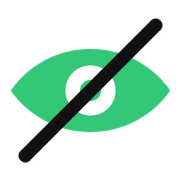
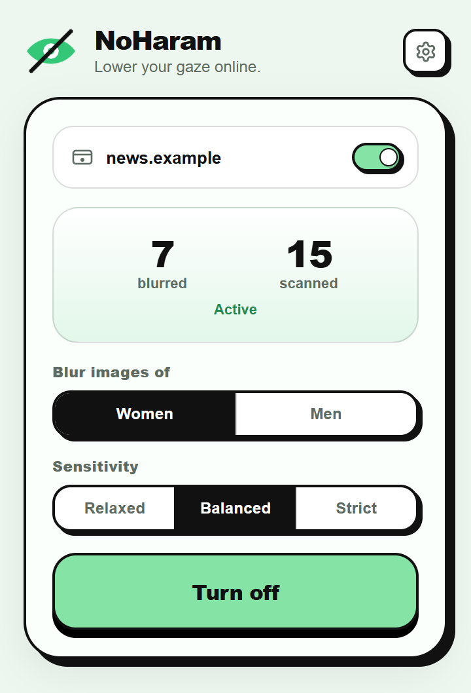
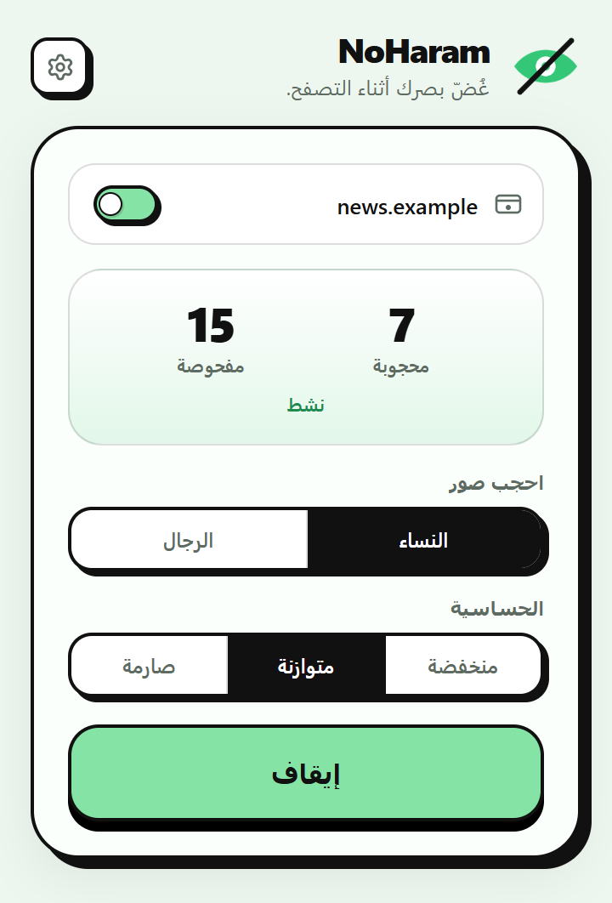
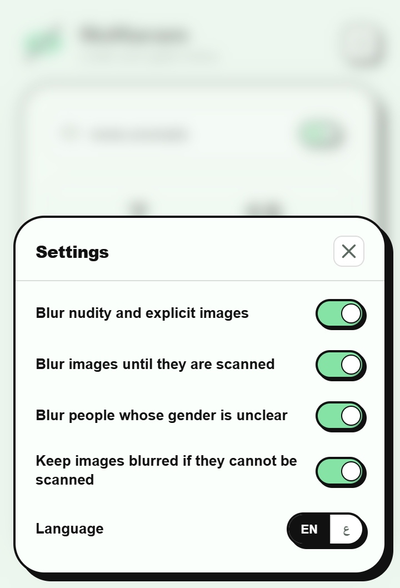
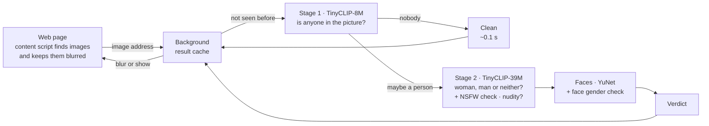

<p align="center">
  
</p>

<h1 align="center">NoHaram</h1>

<p align="center">
  <b>Lower your gaze online.</b><br>
  A browser extension that blurs pictures of women, men, or both, as pages load. Everything runs on your own device.
</p>

<p align="center">
  <a href="LICENSE"></a>
  
  
  
</p>

<p align="center" dir="rtl">
  NoHaram إضافة للمتصفح تحجب صور النساء أو الرجال أو كليهما (حسب اختيارك) فور ظهورها، وتعمل بالكامل على جهازك: لا تُرسَل أي صورة أو رابط إلى أي خادم.
</p>

<p align="center">
  
  &nbsp;
  
  &nbsp;
  
</p>

## Features

- **Choose who to blur:** women, men or both, on every website.
- **Blurs nudity too:** explicit images are blurred whoever is in them. This is on by default.
- **Private by design:** the AI models run inside your browser. No image, URL or browsing history is ever sent anywhere. There are no accounts, analytics or ads.
- **Nothing flashes:** images stay blurred while they load and are checked, then only the matching ones stay blurred.
- **Finds images however a site shows them:**
  - plain images, `srcset` and `<picture>`
  - lazy-loaded images, carousels and CSS backgrounds
  - shadow DOM, iframes and `blob:` images
  - thumbnails down to 24 px
- **You stay in control:**
  - three sensitivity levels
  - a per-site on/off switch
  - right-click **Show this image** or **Blur this image** to fix a single mistake
- **English and Arabic**, with a right-to-left layout in Arabic.
- **Works in** Chrome, Edge, Brave and other Chromium browsers, and in Firefox on desktop and Android.

## Install

You need [Node.js](https://nodejs.org) 22 or newer.

```bash
git clone <this repository>
cd NoHaram
npm install
npm run build
```

Then load the built folder. Use `dist/`, not `src/`:

| Browser | How |
|---|---|
| Chrome / Edge / Brave | Open `chrome://extensions`, turn on **Developer mode**, click **Load unpacked** and choose `dist/chrome` |
| Firefox (desktop) | Open `about:debugging#/runtime/this-firefox`, click **Load Temporary Add-on** and choose `dist/firefox/manifest.json` |
| Firefox for Android | `npx web-ext run -t firefox-android -s dist/firefox` with a USB-connected phone ([guide](https://extensionworkshop.com/documentation/develop/developing-extensions-for-firefox-for-android/)) |

- **Ready-made zips:** prebuilt packages are attached to each [release](../../releases). `npm run zip` builds them yourself, into `dist/noharam-<browser>-<version>.zip`.
- **Firefox:** if the popup says *NoHaram needs access to websites*, click **Allow on all sites**.
- **Skipping the test browser:** `npm install` also downloads a test copy of Chrome, about 150 MB. If you only want to build, use `PUPPETEER_SKIP_DOWNLOAD=1 npm install`.

## Using it

Click the toolbar icon:

- **Site card:** the current website, with a switch to turn filtering off for that site only.
- **Live panel:** how many images on the page were blurred and checked.
- **Blur images of:** Women, Men or both.
- **Sensitivity:** Relaxed, Balanced (the default) or Strict. See [Accuracy](#accuracy).
- **Turn on / Turn off:** pauses or resumes filtering everywhere.
- **Settings** (the gear):
  - *Blur nudity and explicit images* (on by default)
  - *Blur images until they are scanned* (on by default)
  - *Blur people whose gender is unclear* (on by default)
  - *Keep images blurred if they cannot be scanned* (on by default)
  - *Language*

Right-click any image and choose **NoHaram: show this image** or **NoHaram: blur this image** to override a mistake. The badge on the toolbar icon counts the blurred images on the current tab.

## Privacy

NoHaram has no server. The extension makes no network requests of its own except downloading the images the page is already showing, from the same addresses, so it can check them.

On your device, it keeps:
- your settings
- a cache of results, so an image already seen isn't checked twice. The cache stores a SHA-256 hash of each image address with its scores, in the extension's own storage.

Nothing is collected, logged or shared. See [PRIVACY.md](PRIVACY.md).

| Permission | Why |
|---|---|
| Access to all websites | To find the images on every page and download them for checking |
| `storage` | Settings, the result cache, and the badge counts |
| `contextMenus` | The right-click **show / blur this image** items |
| `scripting` | To take over tabs that were already open after the extension updates or restarts |
| `offscreen` (Chrome only) | To run the AI engine in a background page, since MV3 service workers can't start web workers |

## How it works



- **Two stages.** A fast model first rejects pictures without people: logos, charts, products, scenery. That's most of the web. Only pictures that may contain a person get the slower, accurate check, which looks at the whole image and at up to two faces. A small NSFW classifier checks the same pictures for nudity.
- **Zero-shot.** The models are [CLIP](https://arxiv.org/abs/2103.00020)-style image-text models: they compare a picture with plain sentences such as *"a photo of a woman"*, *"a photo of a man"* or *"a logo"*. The sentences are in [`scripts/models/prompts-stage2.json`](scripts/models/prompts-stage2.json). Nothing was trained for this extension.
- **The page stays smooth:**
  - The page itself only tracks which images exist and applies the blur.
  - Downloading, decoding and model inference all happen in the extension's own background workers, on WebAssembly (ONNX Runtime Web, SIMD, 1 thread per worker).
  - Images on screen are checked first, then the next 300 px.
  - While a finger is scrolling, only one image is checked at a time.
- **Fail-safe:** an image that can't be downloaded or checked stays blurred, unless you switch that setting off.

## Models

All models are existing, published models, converted to run in the browser. NoHaram did not train or fine-tune any of them.

| Role | Model | Size | License |
|---|---|---|---|
| Stage 1: anyone in the picture? | [TinyCLIP ViT-8M/16](https://huggingface.co/wkcn/TinyCLIP-ViT-8M-16-Text-3M-YFCC15M), Microsoft, 2023 | 9.4 MB | MIT |
| Stage 2: woman, man or neither | [TinyCLIP ViT-39M/16](https://huggingface.co/wkcn/TinyCLIP-ViT-39M-16-Text-19M-YFCC15M), Microsoft, 2023 | 40.6 MB | MIT |
| Face detection | [YuNet 2023mar](https://github.com/opencv/opencv_zoo/tree/main/models/face_detection_yunet), OpenCV Zoo | 0.23 MB | MIT |
| Face gender (second opinion) | [age-gender-recognition-retail-0013](https://github.com/openvinotoolkit/open_model_zoo/tree/master/models/intel/age-gender-recognition-retail-0013), Intel | 1.4 MB | Apache-2.0 |
| Nudity / explicit images | [nsfw-image-detection-384](https://huggingface.co/Marqo/nsfw-image-detection-384), Marqo, 2024 (ViT-Tiny, full precision) | 22.5 MB | Apache-2.0 |

The built model files are committed in `src/models/`, so building the extension doesn't need Python. To rebuild them from the original downloads, run `npm run models:prepare`. That needs Python with `torch`, `transformers`, `timm`, `onnx`, `onnxruntime` and `onnxsim`. Changes and license texts are listed in [THIRD_PARTY_NOTICES.md](THIRD_PARTY_NOTICES.md).

## Accuracy

No image filter is 100% accurate; people disagree on blurry or partial images too. These numbers were measured in Chrome on **600 images the thresholds were never tuned on**:
- 150 women-only, 150 men-only and 50 mixed photos, plus 100 photos without people, from [Open Images V7](https://storage.googleapis.com/openimages/web/index.html)
- 150 people-free web images from Wikimedia Commons

**Blur women** (default):

| Sensitivity | Women caught | Mixed photos caught | Men-only photos blurred by mistake | People-free photos blurred | People-free web images blurred |
|---|---|---|---|---|---|
| Relaxed | 93% | 64% | 7% | 1% | 0% |
| **Balanced** | 94% | 74% | 12% | 3% | 0% |
| Strict | 97% | 92% | 29% | 21% | 5% |

**Blur men:**

| Sensitivity | Men caught | Mixed photos caught | Women-only photos blurred by mistake | People-free photos blurred | People-free web images blurred |
|---|---|---|---|---|---|
| Relaxed | 95% | 66% | 8% | 2% | 0% |
| **Balanced** | 96% | 80% | 15% | 10% | 0% |

Typical mistakes involve long-haired men, children, masks and helmets, very small or background people, drawings and crowded groups.

**Nudity:** Marqo reports 98.6% accuracy for its NSFW classifier on its own test set of 20,000 images (photos, drawings, memes and AI images). On NoHaram's 1,488 normal labelled photos and graphics it flagged 1.7%: none of the photos without people, 0.2% of the graphics, 1.1% of the men-only photos and 7.5% of the women-only photos. About half of those flagged photos of women show swimwear or underwear. Its catch rate on real explicit content was not re-measured here.

## Speed

Measured on an Intel i7-9750H laptop in Chrome, on the CPU:

| | Time |
|---|---|
| Image without people (most of the web) | ~0.1–0.2 s |
| Image with people (accurate check + faces + nudity check) | ~0.9–1.2 s per worker |
| Image seen before (cache) | ~1 ms |
| Engine start, first page after the browser starts | ~5–8 s |

- **Firefox** is about 1.3× slower.
- **While images wait**, they stay blurred, so a page full of photos of people takes a few seconds to settle.
- **Memory:** each engine worker uses about 160 MB. NoHaram runs 1 worker on phones, 2 on most desktops, and 3 on machines with 8+ cores and 8 GB+ of memory.

## Limitations

- Videos, `<canvas>` drawings and SVG artwork are not filtered.
- Images smaller than 24 px (icons, emoji) are skipped.
- The nudity check only looks at pictures where the first stage sees a person, so for example a close-up without an obvious person can be missed.
- Inference runs on the CPU only. A GPU (WebGPU) path is possible but not built yet.
- Firefox for Android and Edge Mobile have not been tested on real devices.
- The extension is about 89 MB unpacked: 75 MB of models and 14 MB for the runtime.

## Development

```bash
npm run watch                            # rebuild dist/chrome on every change
npm run zip                              # build every browser and write store-ready zips
node test/e2e.mjs --images <dir>         # end-to-end test (add --browser firefox, --select male|both)
node test/lifecycle.mjs --images <dir>   # extension reloads, worker restarts, frozen tabs, back/forward cache
node test/flash.mjs --images <dir>       # no picture may ever appear unblurred before its check
node test/audit-sites.mjs --out <dir> <url>...  # scroll real websites and save every image's verdict
```

The tests need a folder of photos with a `labels.json` that maps each file name to `"female"`, `"male"`, `"both"` or `"none"`. No photos are included in this repository; `npm run models:evalset` downloads a suitable set.

After changing a model or the prompts, recalibrate the thresholds in `src/models/config.json`:

```bash
npm run models:evalset            # evaluation photos and graphics, about 90 MB
npm run build:chrome
npm run models:scores
npm run models:calibrate -- --write
```

See [CONTRIBUTING.md](CONTRIBUTING.md) before opening a pull request.

## License

NoHaram is released under the [MIT License](LICENSE). The bundled models, ONNX Runtime and one icon keep their own licenses (MIT, Apache-2.0 and ISC), listed in [THIRD_PARTY_NOTICES.md](THIRD_PARTY_NOTICES.md).

## Acknowledgements

- [TinyCLIP](https://github.com/microsoft/Cream/tree/main/TinyCLIP) and [ONNX Runtime](https://github.com/microsoft/onnxruntime) by Microsoft
- [YuNet](https://github.com/opencv/opencv_zoo/tree/main/models/face_detection_yunet) by Shiqi Yu and the OpenCV team
- [OpenVINO Open Model Zoo](https://github.com/openvinotoolkit/open_model_zoo) by Intel
- [Lucide](https://lucide.dev) for the settings icon
- [Open Images](https://storage.googleapis.com/openimages/web/index.html) and [Wikimedia Commons](https://commons.wikimedia.org) for the evaluation images
